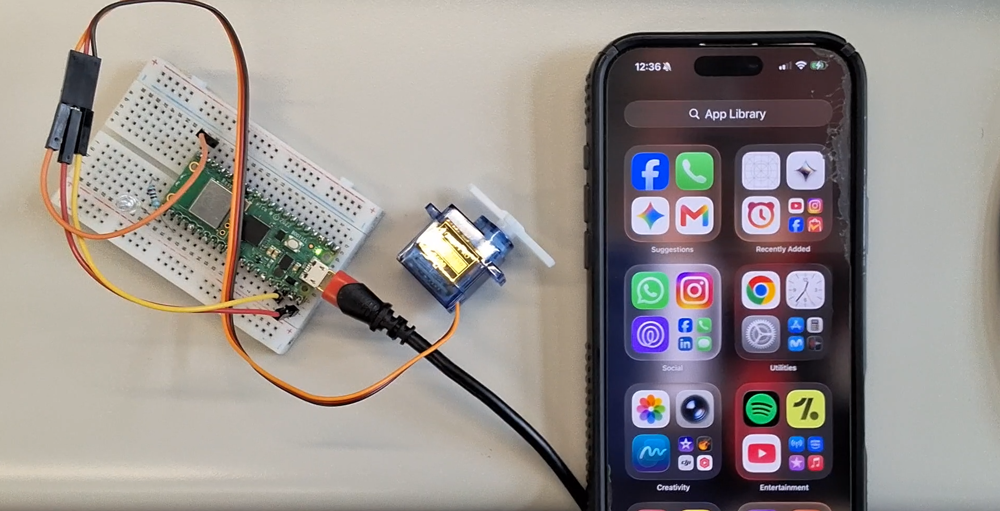
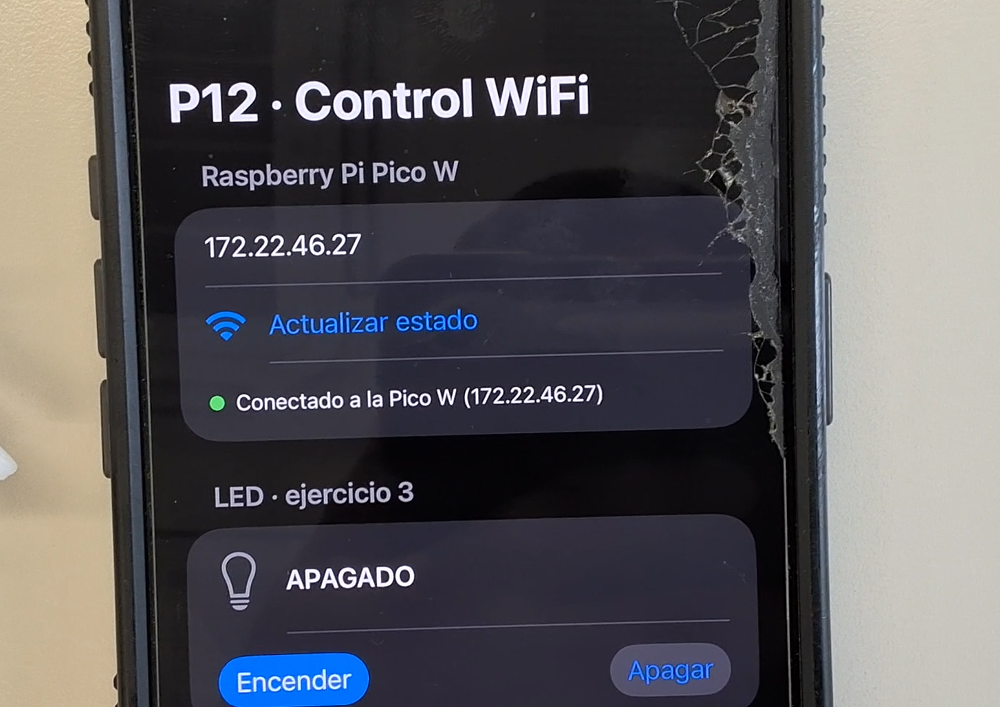
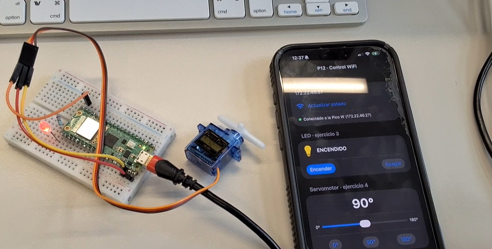
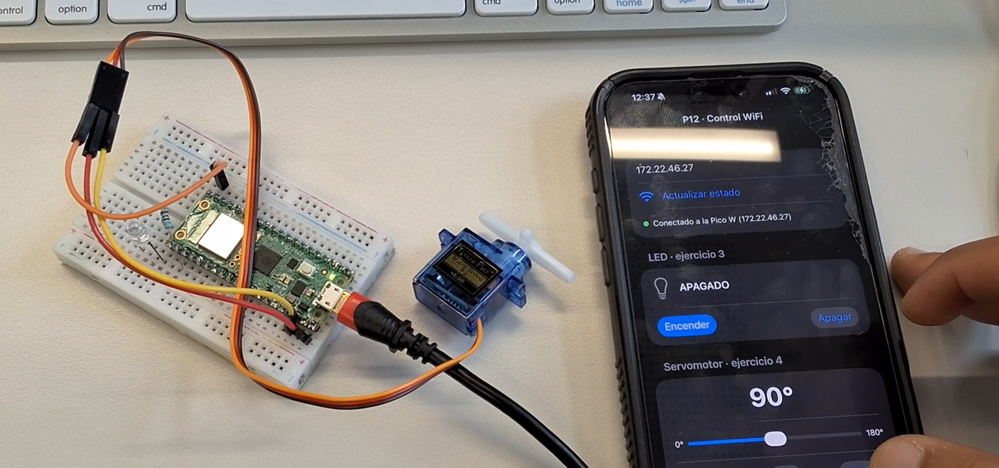
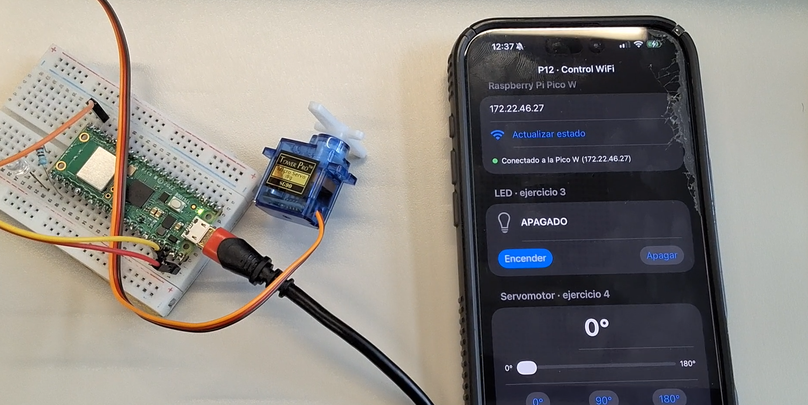
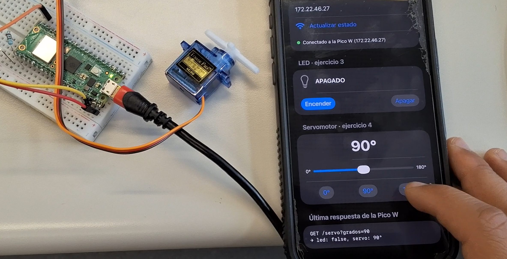
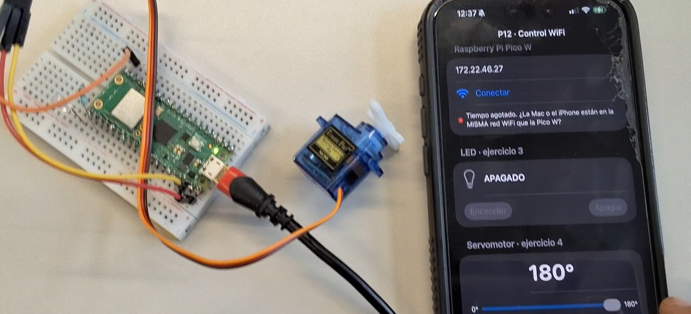
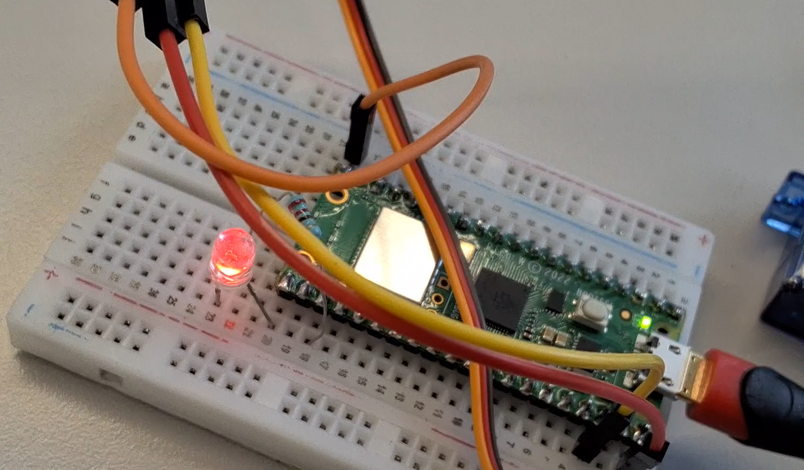

# App iOS · Control WiFi de servomotor con Raspberry Pi Pico W

App desarrollada en **SwiftUI** (patrón MVVM) que se conecta mediante protocolo **HTTP** en red local a una **Raspberry Pi Pico W** ejecutando **MicroPython**, permitiendo controlar en tiempo real un **servomotor (0°–180°)** y un **diodo LED indicador**.

---

## 📁 Estructura del Proyecto

| Archivo / Carpeta | Descripción técnica |
|---|---|
| `P12ControlWifiApp.swift` | Punto de entrada principal (`@main`) del ciclo de vida de la aplicación en SwiftUI. |
| `ContentView.swift` | Interfaz reactiva: campo de dirección IP, botón de conexión/estado, interruptores del LED y slider/botones rápidos del servomotor. |
| `ControlViewModel.swift` | Capa lógica y de estado (`@MainActor`, `ObservableObject`), persistencia en `UserDefaults` y binding reactivo `@Published`. |
| `PicoAPI.swift` | Capa de red desacoplada con `URLSession` efímera, peticiones asíncronas (`async/await`) y decodificación automática `Codable`. |
| `Info_plist_fragmento.xml` | Parámetros de seguridad de red en iOS: `NSAllowsLocalNetworking` / `NSAllowsArbitraryLoads` y `NSLocalNetworkUsageDescription`. |
| `PicoW_MicroPython/config.py` | Parámetros de red inalámbrica para la Pico W (SSID: `Otoño26`, Password y País). |
| `PicoW_MicroPython/wifi_conexion.py` | Módulo reutilizable de conexión Station con temporizador y parpadeo de LED onboard. |
| `PicoW_MicroPython/ej4_servo_wifi.py` | Servidor HTTP de sockets para microcontrolador que modula el PWM (GP15) y conmuta el pin GP16. |
| `resumen_de_soluci_n_de_errores_xcode.md` | Bitácora técnica detallada de resolución de errores de compilación, enlazador y firma de código. |
| `imagenes/` | Galería fotográfica y capturas de pantalla de la prueba funcional en iPhone físico y planta física. |

---

## 🛠️ Conexión Física (Hardware)

* **Microcontrolador:** Raspberry Pi Pico W (firmware MicroPython oficial RP2040-W).
* **Servomotor SG90 (o MOT-100):**
  * Señal PWM (Naranja/Amarillo) → **GP15** (Pin físico 20).
  * Alimentación positiva (+) (Rojo) → **VBUS** (Pin físico 40, 5 V de alimentación USB).
  * Tierra (-) (Café/Negro) → **GND** (Pin físico 38).
* **Diodo LED con resistencia limitadora:**
  * Ánodo (+) → **GP16** (Pin físico 21) a través de resistencia de 220 Ω.
  * Cátodo (-) → **GND** (Pin físico 23).

---

## 📡 Especificación de la API HTTP de la Pico W

Todas las rutas operan sobre el método `GET` en el puerto 80 y retornan un payload JSON unificado con el estado del sistema:

| Endpoint | Parámetros | Respuesta JSON de ejemplo | Acción en Hardware |
|---|---|---|---|
| `/` | Ninguno | Documento HTML interactivo | Servir panel web para pruebas directas en navegador. |
| `/estado` | Ninguno | `{"led": false, "servo": 90, "ip": "172.22.46.27"}` | Consulta de telemetría sin alterar salidas. |
| `/led/on` | Ninguno | `{"led": true, "servo": 90, "ip": "172.22.46.27"}` | Pone en nivel alto (3.3 V) el pin GP16. |
| `/led/off` | Ninguno | `{"led": false, "servo": 90, "ip": "172.22.46.27"}` | Pone en nivel bajo (0 V) el pin GP16. |
| `/servo` | `grados=0..180` | `{"led": false, "servo": 180, "ip": "172.22.46.27"}` | Ajusta ciclo de trabajo PWM de 50 Hz en GP15. |

---

## 🚀 Tutorial de Configuración, Compilación y Ejecución

### 1. Carga de MicroPython en la Raspberry Pi Pico W
1. Se conectó la Pico W vía USB al equipo (detectada en Windows en el puerto serie `COM9`).
2. Utilizando la herramienta `mpremote` (o el IDE Thonny), se copiaron los archivos al sistema de archivos raíz de la Pico:
   * `config.py` con las credenciales de la red WiFi `Otoño26`.
   * `wifi_conexion.py`.
   * `ej4_servo_wifi.py` guardado como **`main.py`** para arranque autónomo al encender.
3. Al conectarse a la red, la Pico W adquiere su IP (ejemplo: `172.22.46.27`) e inicia el socket en el puerto 80.

### 2. Configuración del Proyecto en Xcode (macOS)
1. Se creó un proyecto de tipo **iOS App** con interfaz **SwiftUI** y lenguaje **Swift**.
2. Se integraron los archivos de código fuente:
   * `P12ControlWifiApp.swift` (punto de entrada `@main`).
   * `ContentView.swift`.
   * `ControlViewModel.swift`.
   * `PicoAPI.swift`.
3. En la sección **Target > Info > Custom iOS Target Properties**, se configuraron los permisos de comunicación en red local:
   * `App Transport Security Settings` > `Allow Arbitrary Loads` (o `Allows Local Networking`) = `YES`.
   * `Privacy - Local Network Usage Description`: *"La app se conecta a la Raspberry Pi Pico W en tu red WiFi para controlar el LED y el servomotor."*

### 3. Despliegue en Dispositivo Físico (iPhone 16 Pro Max)
1. Se activó el **Modo Desarrollador** en el iPhone: *Ajustes > Privacidad y seguridad > Modo de desarrollo* (requiere reinicio del terminal).
2. Se conectó el iPhone vía USB a la Mac y se autorizó la confianza en la computadora.
3. En Xcode, se seleccionó el equipo personal de firma (*Personal Team*) en *Signing & Capabilities*.
4. Se autorizó la firma de código (*codesign*) en el llavero de macOS.
5. Se seleccionó el iPhone 16 Pro Max como destino de compilación y se ejecutó la app (`Cmd + R`).
6. En el iPhone, se confió en el perfil de desarrollo en *Ajustes > General > VPN y gestión de dispositivos*.

---

## 📸 Resultados y Evidencias Fotográficas

A continuación se presentan las evidencias documentadas durante la prueba en tiempo real, vinculando la interacción en el iPhone 16 Pro Max con la respuesta física de los actuadores y componentes de la planta.

### 1. Instalación y Apertura en iPhone 16 Pro Max
La aplicación `P12ControlWifi` instalada exitosamente en el dispositivo físico, disponible en la biblioteca de apps.

---

### 2. Conexión Establecida y Estado Inicial (LED Apagado)
Al ingresar la dirección IP asignada a la Pico W (`172.22.46.27`) y pulsar **Conectar**, el indicador pasa a color verde y se confirma el estado apagado del diodo LED en hardware.

---

### 3. Comando de Encendido del LED por WiFi
Al pulsar **Encender** en la aplicación móvil, se transmite el requerimiento `GET /led/on`, actualizándose el estado visual a "ENCENDIDO" y conmutando el LED conectado al pin GP16 de la planta física.

---

### 4. Control del Servomotor a Posición Intermedia (90°)
Control del servomotor posicionado a 90 grados mediante el slider interactivo y botón de acceso rápido, manteniendo el pulso PWM calibrado.

---

### 5. Control del Servomotor a Extremo Mínimo (0°)
Transmisión del comando `GET /servo?grados=0` al pulsar el botón de 0°, desplazando el brazo mecánico del servo SG90 al límite inferior.

---

### 6. Control del Servomotor a Extremo Máximo (180°)
Transmisión del comando `GET /servo?grados=180` al pulsar el botón de 180°, alcanzando el límite angular superior y recibiendo la confirmación en el registro de respuesta.

---

### 7. Manejo de Excepciones y Tolerancia a Fallos de Red
Validación del sistema de gestión de errores ante desconexión o retardo excesivo, informando de forma clara al usuario sobre el estado de la comunicación (*Tiempo agotado*).

---

### 8. Montaje Integral de la Planta Física
Vista de conjunto de la Raspberry Pi Pico W, protoboard de pruebas, cableado hacia el servomotor y resistencias limitadoras.

---

## 🛡️ Solución de Incidencias Técnicas
Para consultar la bitácora completa de los errores resueltos durante el proceso de desarrollo en Xcode (problemas de enlazador `_main`, firmas de Llavero, conformidad de `@Published` y permisos `Info.plist`), consultar el documento:
👉 **[resumen_de_soluci_n_de_errores_xcode.md](resumen_de_soluci_n_de_errores_xcode.md)**.
